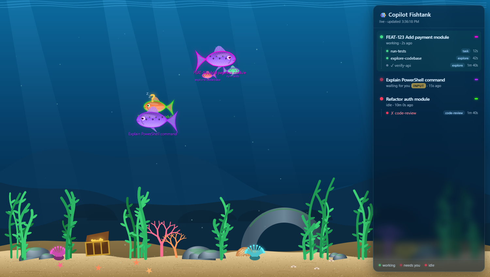

# 🐠 Copilot Fishtank

A live aquarium for your [GitHub Copilot CLI](https://docs.github.com/copilot/how-tos/use-copilot-agents/use-copilot-cli) sessions.
Every session is a glowing fish: it **races around while the agent is working**, slows down with a `?` when it's
**waiting for you**, and drifts lazily with `zZ` when it's **idle**. Subagents swim along as little fish.



## Features

- One fish per Copilot CLI session that was active in the last hour, labelled with its session name (set with `/rename`).
- Small fish for every running subagent.
- Side panel listing sessions with a 🟢 working / 🔴 idle / blinking 🔴 waiting-for-input dot, and their subagents
  underneath (running, ✓ done, ✗ failed) with agent type and duration.
- Starts automatically when you launch `copilot`, and shuts down when the last Copilot CLI closes.
- No dependencies besides Node.js. Read-only: it only reads Copilot's local session logs and listens on `127.0.0.1`.

## Requirements

- [GitHub Copilot CLI](https://docs.github.com/copilot/how-tos/use-copilot-agents/use-copilot-cli)
- [Node.js](https://nodejs.org) 18 or newer
- macOS/Linux: `bash` and `curl`

## Install

Clone the repo somewhere permanent (the hook points to this folder), then run the installer.

**Windows (PowerShell)**

```powershell
git clone https://github.com/VinnieVH/copilot-fishtank.git
cd copilot-fishtank
powershell -ExecutionPolicy Bypass -File .\install.ps1
```

**macOS / Linux**

```bash
git clone https://github.com/VinnieVH/copilot-fishtank.git
cd copilot-fishtank
./install.sh
```

That's it. Start `copilot` and the fishtank opens in your browser at <http://localhost:4321>.

## How it works

- The installer adds a user-level Copilot CLI [hook](https://docs.github.com/copilot/reference/hooks-configuration)
  at `~/.copilot/hooks/fishtank.json` (respects `COPILOT_HOME`). On every `sessionStart` it runs
  `start-fishtank.ps1` / `start-fishtank.sh`, which starts the server in the background if it isn't running yet
  and opens the browser. If the server is already running, it does nothing.
- `server.js` tails `~/.copilot/session-state/<session>/events.jsonl` every second and derives each session's state
  from the event stream (turn start/end, tool calls, permission requests, subagent start/complete). It pushes
  updates to the page over Server-Sent Events.
- Every 5 seconds the server checks the `inuse.<pid>.lock` files of the sessions. Once no Copilot CLI process has
  been running for ~15 seconds it shows a "Copilot closed" screen in the page and exits. With multiple Copilot
  windows open it keeps running until the last one closes.

## Run manually

```bash
npm start            # or: node server.js
```

Then open <http://localhost:4321>. When started manually it still exits once no Copilot CLI is running; set
`FISHTANK_KEEP_ALIVE=1` to keep it up.

## Configuration

| Environment variable   | Default                    | Description                                   |
| ---------------------- | -------------------------- | --------------------------------------------- |
| `FISHTANK_PORT`        | `4321`                     | Port to listen on (localhost only)            |
| `COPILOT_SESSION_DIR`  | `~/.copilot/session-state` | Where Copilot CLI stores its session logs     |
| `FISHTANK_KEEP_ALIVE`  | unset                      | Set to `1` to disable auto-shutdown           |

## Uninstall

```powershell
powershell -ExecutionPolicy Bypass -File .\uninstall.ps1   # Windows
```

```bash
./uninstall.sh                                             # macOS / Linux
```

This removes the hook and stops the server. Then delete the folder.

## License

[MIT](LICENSE)
