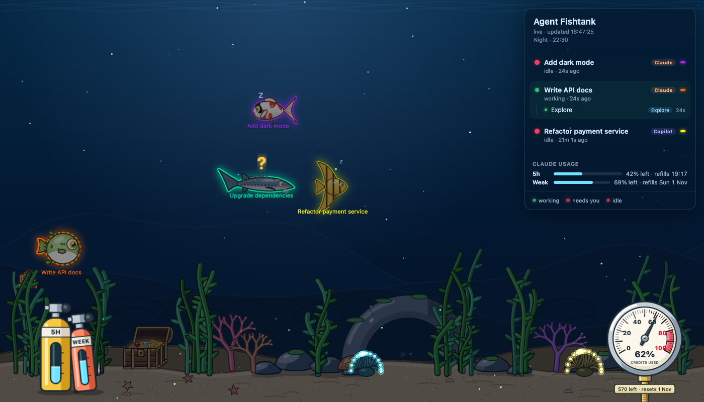

# 🐠 Agent Fishtank

A desktop aquarium for your [GitHub Copilot CLI](https://docs.github.com/copilot/how-tos/use-copilot-agents/use-copilot-cli)
and [Claude Code](https://code.claude.com/docs) sessions. Use either one, or both side by side.
Every session is a glowing fish: it **races around while the agent is working**, slows down with a `?` when it's
**waiting for you**, and drifts lazily with `zZ` when it's **idle**. Subagents swim alongside as little copies of their parent.




## Features

- One fish per Copilot CLI or Claude Code session that was active in the last hour, labelled with its session name
  (the name you set with `/rename`, or else the start of your first prompt).
- Cartoon-style fish with ink outlines and big glossy eyes, rendered with WebGL ([PixiJS](https://pixijs.com)); their bodies
  bend as they swim and they glow in their session's neon colour. The seabed (seaweed, anemones, coral, rocks, a stone
  arch and a treasure chest) is drawn in the same cartoon style.
- Each session gets its own species — tropical fish, koi, sturgeon, angelfish or pufferfish. New sessions get the species
  that's least common in the tank so you get a good mix, and a session keeps its species (even across page reloads).
- A small fish of the same species and colours for every running subagent, swimming close to its parent.
- Every few minutes a humpback whale or a great white shark glides by far in the background, never both at once (start the app with `--whale` or `--shark` to summon one right away).
- When every session is idle (or there are none), a little red crab comes out to stroll along the sand: he looks
  around, snaps his claws or does a little dance. When a new fish appears or a session gets busy, he jumps in fright and
  sprints off the screen.
- Click the water to drop a pinch of fish food: it sinks slowly, and the nearest fish that isn't already eating darts
  over and gobbles it up flake by flake. Uneaten flakes settle on the sand and fade away.
- Day/night cycle that follows the real sun for your PC's clock and timezone: bright water by day, a warm glow at dawn
  and dusk, and moonlit water at night with bioluminescent plankton and extra-glowy fish. The location is estimated
  from your timezone; set it exactly with `--lat=51.05 --lon=3.72`. Preview a time with `--time=22:30`, or watch a
  whole day in a minute with `--timelapse` (see [Options](#options)).
- Side panel listing sessions with a 🟢 working / 🔴 idle / blinking 🔴 waiting-for-input dot and a Copilot or Claude
  badge, and their subagents underneath (running, ✓ done, ✗ failed) with agent type and duration. "Waiting" means a
  permission prompt or a question for you (Copilot's `ask_user`, Claude's `AskUserQuestion` or plan approval).
- Your Copilot premium requests, like VS Code's "80% used": a pressure gauge in front of the tank (bottom right) shows
  the credits used from 0 to 100%, with a red zone for the last 20% that pulses once the needle is in it (faster
  under 10% left). A plaque on its pipe shows the credits left and the reset date. The gold in the treasure chest
  shrinks as credits run out (empty at 0%), with one diamond, ruby or sapphire for every 20% left. Read from the
  quota snapshot the CLI writes to its session logs, so no extra login or API call.
- Your Claude Pro/Max plan usage as a diver's two scuba tanks standing in the sand by the rocks: the big yellow one
  for the 5-hour limit, the slim coral one leaning on it for the weekly limit. A sight glass on each shows the air
  left (cyan, amber under 25%, red under 10%), and a dive slate in the sand says how much is left and when it refills.
  An almost empty tank leaks bubbles from its valve. Claude Code only gives this usage to its status line, so the
  app wraps your status line (see below); it looks exactly as before.
- A desktop app for macOS and Windows. It opens by itself when you start a `copilot` or `claude` session (also in the
  Claude desktop app), and quits after the last one closes. Closing its window while sessions run only hides it.
- It only listens on `127.0.0.1` and never steers your agent: it reads Copilot's local session logs and receives
  Claude Code's hook events, always answering with an empty response.

## Install

Download the installer for your computer from the [latest release](https://github.com/VinnieVH/agent-fishtank/releases/latest):

| Computer                 | Download                              |
| ------------------------ | ------------------------------------- |
| Mac with Apple Silicon   | `Agent-Fishtank-<version>-arm64.dmg`  |
| Mac with Intel           | `Agent-Fishtank-<version>-x64.dmg`    |
| Windows (x64 or Arm)     | `Agent-Fishtank-Setup-<version>.exe`  |

You also need [GitHub Copilot CLI](https://docs.github.com/copilot/how-tos/use-copilot-agents/use-copilot-cli) and/or
[Claude Code](https://code.claude.com/docs). Nothing else: no Node.js.

**macOS:** open the `.dmg` and drag Agent Fishtank to Applications. The app isn't signed by Apple yet, so the first
time macOS refuses to open it: open System Settings → Privacy & Security, scroll down to the message about
Agent Fishtank and click **Open Anyway**. (Or in Terminal: `xattr -dr com.apple.quarantine "/Applications/Agent Fishtank.app"`.)

**Windows:** run the installer. It isn't signed yet, so SmartScreen may warn: click **More info** → **Run anyway**.

On first start the app offers to connect to the CLIs it finds. Click **Connect**, and from then on the fishtank opens
whenever you start a session. You can connect and disconnect any time from the menu (on Windows the File menu; press
Alt to show it).

> **Before deleting the app on macOS**, choose **Disconnect** in the Agent Fishtank menu, or Claude Code keeps calling
> hooks that are gone (and shows hook errors). The Windows uninstaller disconnects by itself.

> **Upgrading from the browser version** (`install.sh` / `install.ps1`)? Just connect the app: it replaces the old
> hooks and keeps your own status line. Then delete the old folder.

## How it works

- **Starting:** connecting adds a session-start hook to each CLI that runs the app's small command line
  (`fishtank start`, shipped inside the app as `bin/fishtank.sh` / `bin/fishtank.cmd`). It starts the app unless it's
  already running. The command line runs on the app's own binary, so you don't need Node.js.
- **Copilot CLI:** the hook lives in `~/.copilot/hooks/fishtank.json` (respects `COPILOT_HOME`). The app tails
  `~/.copilot/session-state/<session>/events.jsonl` every second and derives each session's state from the event
  stream (turn start/end, tool calls, permission requests, subagent start/complete). It also reads the latest
  premium-request quota that the CLI logs with each model call (`quotaSnapshots`), for the credits gauge.
- **Claude Code:** Claude Code's transcript format is internal and changes between versions, so the fishtank uses its
  documented [hooks](https://code.claude.com/docs/en/hooks) instead, in `~/.claude/settings.json` (respects
  `CLAUDE_CONFIG_DIR`). Besides the start hook, `http` hooks POST every prompt, tool call, permission prompt, stop and
  subagent start/stop to `http://127.0.0.1:4321/hook/claude`. Your own hooks and settings are left alone; the previous
  file is kept as `settings.json.fishtank-backup`, and nothing is changed if the file isn't valid JSON.
  Hooks don't fire on everything (not when you press Esc or answer a permission prompt), so the app also reads the
  small file Claude Code keeps per running session (`~/.claude/sessions/<pid>.json`), which says the moment a session
  turns busy, idle or waiting, and the name you gave it. That file isn't documented; if a Claude Code update changes
  it, the fishtank falls back to the hooks alone.
- **Claude plan usage:** connecting sets Claude Code's status line to `fishtank statusline`, which passes the
  `rate_limits` part of its input to the app and then runs your own status line (kept, base64-encoded, at the end of
  the command) with the same input, so you see the same status line as before. Without a status line of your own it
  shows the model and your usage (any status line hides Claude Code's footer hints, so it shows something useful).
  The last usage is kept in a temp file so the tanks show right away after a restart. The Claude desktop app has no
  terminal status line, so its sessions don't update the tanks.
- The app runs the server (`server/server.ts`): it merges both into one live feed and pushes it to the window over
  Server-Sent Events.
- Long sessions write big logs. The app reads a Copilot log only from its last 8 MB when it first sees it and then
  just the new lines, never reads Claude Code's transcripts, and forgets sessions an hour after they went quiet.
- Every 5 seconds the app checks whether a CLI is still running: Copilot's `inuse.<pid>.lock` files and Claude Code's
  `~/.claude/sessions/<pid>.json` files. Once neither has been running for ~15 seconds it quits. Opened by hand, it
  stays until a session has come and gone.

## Options

Start the app with these to change what the tank shows, e.g. on macOS
`open -a "Agent Fishtank" --args --time=22:30 --shark`, on Windows `"Agent Fishtank.exe" --time=22:30 --shark`:

| Option                     | Description                                                         |
| -------------------------- | ------------------------------------------------------------------- |
| `--lat=51.05 --lon=3.72`   | Your exact location for the sun position (default: guessed from timezone) |
| `--time=22:30`             | Show the tank at a fixed time of day                                |
| `--timelapse`              | Run a whole day in about a minute                                   |
| `--whale` / `--shark`      | Summon the humpback whale or the great white shark right away       |
| `--crab`                   | Keep the crab out on the sand, even while sessions are busy (he still bolts when a new fish arrives) |

| Environment variable   | Default                    | Description                                   |
| ---------------------- | -------------------------- | --------------------------------------------- |
| `FISHTANK_PORT`        | `4321`                     | Port the app listens on (localhost only). The hooks use the port set when connecting, so connect again after changing it. |
| `CLAUDE_CONFIG_DIR`    | `~/.claude`                | Claude Code's config folder (settings, running sessions) |
| `COPILOT_HOME`         | `~/.copilot`               | Copilot CLI's folder (hooks, session logs)    |

## Development

The page is a [Vite](https://vite.dev) + TypeScript + PixiJS app in `src/`. The desktop app is
[Electron](https://www.electronjs.org): `electron/main.ts` runs the server from `server/` and shows the page, and
Vite bundles both into `dist-electron/`. The server can also run on its own straight from source with Node 22.18+
(`node server/index.ts`), so it may only use TypeScript syntax Node can strip (no enums or parameter properties),
which `npm run typecheck` enforces through `tsconfig.server.json`.

| Path                 | What                                                                   |
| -------------------- | ---------------------------------------------------------------------- |
| `src/main.ts`        | Sets up the Pixi app, the layers, the session → fish sync and the loop |
| `src/scene/`         | Fish (swim physics, bending body, labels), water, sky overlay, whale and shark passers-by, crab, fish food, credits gauge, air tanks |
| `src/art/`           | Canvas 2D painters for the fish, terrain, whale, shark and crab, used as textures |
| `src/sky.ts`         | Sun position and day/night light                                       |
| `src/species.ts`     | Species table and the least-common species picker                      |
| `src/panel.ts`       | Side panel and the live `/events` connection                           |
| `src/credits.ts`     | Credits used/left, low warning and chest gold level from the quota     |
| `src/limits.ts`      | Claude plan usage → air left in the 5-hour and weekly tanks            |
| `shared/types.ts`    | The live feed's types, shared by the server and the page               |
| `server/server.ts`   | HTTP server: `/events` feed, `/hook/claude`, `/statusline/claude`, static page, idle check |
| `server/copilot.ts`  | Copilot CLI: tails the session logs, quota, process check              |
| `server/claude.ts`   | Claude Code: hook events and running-session files → session state     |
| `server/index.ts`    | Runs the server on its own, for development                            |
| `electron/main.ts`   | The desktop app: window, menu, first-run connect dialog, quitting when idle |
| `electron/connect.ts` | Connects/disconnects Claude Code and Copilot CLI (hooks, status line)  |
| `electron/cli.ts`    | The app's command line: `start`, `statusline`, `disconnect`            |
| `electron/bin/`      | Launchers that run the command line on the app's own binary           |
| `build/`             | App icon and the Windows uninstaller hook                              |

```bash
npm run app          # build and run the desktop app from source (it can't be connected from source)
npm start            # or run just the server: then open http://localhost:4321 (FISHTANK_KEEP_ALIVE=1 keeps it up)
npm run dev          # page with hot reload on http://localhost:5173, proxies /events to the server
npm run typecheck    # TypeScript (page, server and app)
npm test             # unit tests (Vitest)
npm run dist:dir     # package the app for this computer into release/ (unpacked, quick)
npm run dist         # build the installers into release/ (.dmg on macOS, .exe on Windows)
```

Releases are built by GitHub Actions (`.github/workflows/release.yml`) when you push a tag like `v1.1.0`: it builds and
smoke-tests the app on macOS and Windows and attaches the installers to the release.

## License

[MIT](LICENSE)
